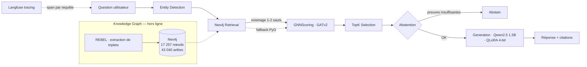

# GraphRAG & LLMOps

<div align="center">

**RAG sur graphe de connaissances, industrialisé en production**

QA multi-sauts HotpotQA · REBEL → Neo4j → GNN GATv2 → Qwen2.5-1.5B QLoRA 4-bit

[](https://github.com/Mohamed-ettaouil12/graphrag-llmops/actions/workflows/eval-gate.yml)
[](https://www.python.org)
[](https://pytorch.org)
[](https://neo4j.com)
[](https://fastapi.tiangolo.com)
[](https://langfuse.com)
[](LICENSE)

</div>

---

> **En une phrase** — un pipeline de question-réponse multi-sauts qui extrait un graphe de connaissances (REBEL + Neo4j), y propage un scoring GNN entraîné sur les *supporting facts*, puis génère des réponses citées avec un LLM 1,5B quantisé 4-bit — le tout servi par une API FastAPI tracée, routée, cacheée et évaluée en continu (LLMOps).

---

## Table des matières

- [Pourquoi ce projet](#pourquoi-ce-projet)
- [Architecture](#architecture)
- [LLMOps — industrialisation](#llmops--industrialisation)
- [Résultats mesurés](#résultats-mesurés)
- [Démarrage rapide](#démarrage-rapide)
- [Configuration](#configuration)
- [Opérations (Makefile)](#opérations-makefile)
- [Structure du dépôt](#structure-du-dépôt)
- [Documentation](#documentation)
- [Limites & roadmap](#limites--roadmap)
- [Reproductibilité](#reproductibilité)
- [Auteur](#auteur)

---

## Pourquoi ce projet

La QA multi-sauts exige de **combiner des faits dispersés dans plusieurs documents**. Deux échecs classiques :

| Échec | Constat mesuré |
|-------|----------------|
| RAG lexical (BM25, cosinus) | Ne propage pas l'information relationnelle entre documents |
| LLM de base, sans retrieval cité | Hallucination > 70 %, format de réponse instable (0 % valide) |

**Notre réponse** : un graphe de connaissances + un GNN qui apprend quels triplets sont des preuves, + un LLM fine-tuné qui cite ses sources ou s'abstient.

**Résultats en un coup d'œil**

| Indicateur | Valeur |
|------------|--------|
| F1 (test, 300 questions) | **0,264** · EM 0,163 |
| Recall@5 des supporting facts | **0,901** |
| Gain GNN vs BM25 seul | **+0,022 R@5** (0,729 vs 0,707) |
| Format de réponse valide | **100 %** (après fine-tuning) |
| Latence | **0,61 s/question** (4-bit, RTX 3050 Ti 4 Go) |

---

## Architecture



**Sept nœuds LangGraph** (`src/orchestrator/`) :
`EntityDetection → Neo4jRetrieval → PyGFallback → GNNScoring → TopKSelection → Abstention → Generation` — chaque nœud logue ses entrées/sorties pour la traçabilité.

**Trois étages hors ligne** :

1. **Knowledge Graph** — extraction de triplets par REBEL (`Babelscape/rebel-large`), normalisation, labelling automatique sur les *supporting facts*, peuplement Neo4j avec contraintes d'unicité.
2. **Scoring GNN** — GATv2 (2 couches, hidden 128, 4 têtes) + feature BM25 ; entraîné avec `BCEWithLogitsLoss` pondéré, early stopping sur R@5 val. Meilleure config : **A8** (`checkpoints/gnn_best.pt`).
3. **Génération** — Qwen2.5-1.5B-Instruct quantisé NF4, LoRA r=16 (2 epochs, 686 exemples SFT), modèle fusionné 4-bit : ~2,5 Go VRAM, **1,81× plus rapide** que l'adaptateur.

---

## LLMOps — industrialisation

| Composant | Implémentation | Détail |
|-----------|----------------|--------|
| **Routage par complexité** | `llmops/router.py` | Heuristique → mistral-small (simple) / mistral-large (complexe), fallback dégradé |
| **Adaptateur LLM unifié** | `llmops/adapter.py` | Contrat commun local (Qwen 4-bit) / hébergé (Mistral) |
| **Cache & idempotence** | `llmops/cache.py` | Traçabilité `prompt_version`, `route_taken` |
| **Pricing** | `llmops/pricing.py` | Coût USD/token — small ~$0,000011, large ~$0,000089 |
| **Tracing** | Langfuse | Un span par requête : tokens, coût, latence, entités, triplets, abstention |
| **Prompt registry** | `prompts/registry.yaml` | Version active par étape, rollback sans redémarrage |
| **A/B testing de prompts** | `scripts/ab_prompts.py` | `generation_v1` vs `generation_v2` (abstention stricte + contrat de citation) |
| **Éval continue** | `eval/run_ragas.py` | RAGAS + juge, venv isolé (`eval/bootstrap.sh`), dataset doré gelé (sha256) |
| **Gates CI** | `.github/workflows/eval-gate.yml` | Éval sur PR + full eval nocturne (02:00 UTC) |
| **Alerting** | `.github/workflows/daily-alert.yml` | Vérification quotidienne 01:00 UTC |

**Cibles qualité suivies** : fidélité ≥ 0,90 (CI P07) · p95 ≤ 1,2 s warm cache · ≤ 0,002 $/requête · ≥ 45 % de réduction de coût vs forced-large · non-infériorité (aucune métrique en baisse > 5 %).

---

## Résultats mesurés

### Éval finale — test (300 questions), config C5 (Run1 fusionné + GNN top-5)

| Métrique | Test | Val |
|----------|------|-----|
| EM | **0,1633** | 0,1950 |
| F1 | **0,2636** | 0,2784 |
| Format OK | **99,7 %** | 100 % |
| Latence | **0,607 s** | 0,618 s |
| Recall@5 supporting facts | **0,9009** | 0,9357 |

### Ablations retrieval (val)

| Configuration | R@3 | R@5 | R@10 |
|---------------|-----|-----|------|
| **GNN A8 (GATv2 + BM25)** | **0,5971** | **0,7292** | 0,8917 |
| BM25 seul | 0,5339 | 0,7074 | 0,8905 |
| Neo4j sans GNN (1-2 hops + BM25) | 0,5175 | 0,6634 | 0,8685 |
| Neo4j + Cross-Encoder reranker | 0,4180 | 0,4426 | 0,4572 |

### Hallucination — juge embedding (bge-small, seuil 0,5), 100 réponses val

**41 %** de réponses hallucinées · 59 % de claims supportés.
Causes : erreurs de raisonnement (45 %) · bruit GNN label=0 cité (35 %) · information absente du top-5 (20 %).

### Impact du fine-tuning (val, GNN top-5)

| Config | EM | F1 | Format OK |
|--------|-----|-----|-----------|
| Qwen base (C3) | 0,000 | 0,024 | 0 % |
| **Run1 fine-tuné (C5)** | **0,195** | **0,278** | **100 %** |

---

## Démarrage rapide

Prérequis : Python 3.11, Docker, ~4 Go VRAM pour l'inférence locale.

```bash
# 1. Cloner & installer
git clone https://github.com/Mohamed-ettaouil12/graphrag-llmops.git
cd graphrag-llmops
python -m venv .venv && source .venv/bin/activate
pip install -r requirements.txt

# 2. Configuration (copier le template, remplir si besoin)
cp .env.example .env

# 3. Base de données graphe
docker compose up -d neo4j && sleep 20

# 4. API
.venv/bin/python -m uvicorn src.api.main:app --host 0.0.0.0 --port 8000 --workers 1

# 5. Première requête
curl -s -X POST "http://localhost:8000/ask" \
  -H "Content-Type: application/json" \
  -d '{"question": "What is the capital of France?"}' | jq

# 6. Vérifier la santé de l'installation
.venv/bin/python scripts/check_env.py
```

Démo guidée (multi-saut, abstention, cas d'erreur) :

```bash
.venv/bin/python scripts/demo.py
```

---

## Configuration

> `.env` n'est **jamais** commité — `git rm --cached .env` est déjà appliqué ; le template `.env.example` sert de référence.

| Variable | Rôle | Défaut |
|----------|------|--------|
| `MISTRAL_API_KEY` | LLM hébergé (réservé au router LLMOps) | vide — pipeline 100 % local |
| `LANGFUSE_PUBLIC_KEY` / `LANGFUSE_SECRET_KEY` | Tracing Langfuse, brancheable sur les 7 nœuds | vide (spans no-op) |
| `LANGFUSE_HOST` | Endpoint Langfuse | `https://cloud.langfuse.com` |
| `NEO4J_URI` / `NEO4J_USER` / `NEO4J_PASSWORD` | Accès Neo4j (partagé avec `docker-compose.yml`) | `bolt://localhost:7687` / `neo4j` / — |

**Mode dégradé** : sans clés API, le pipeline fonctionne intégralement en local — modèle Qwen 4-bit, spans Langfuse no-op, zéro appel externe.

---

## Opérations (Makefile)

```bash
make install           # installation venv + dépendances
make test              # suite pytest complète
make lint              # ruff (llmops/, app/, eval/, tests/, scripts/)
make check-env         # validation des variables d'environnement
make bench             # benchmark vs baseline → reports/BASELINE.md
make compare           # comparaison de runs
make eval              # éval RAGAS (venv juge bootstrappé automatiquement)
make eval-smoke        # éval rapide (échantillon réduit)
make validate-dataset  # intégrité du dataset doré (sha256)
make accept-dataset-change # acceptation explicite d'un changement de dataset
make update-baseline   # mise à jour de la baseline de référence
```

**Couverture de tests** : API (`test_api.py`, `test_api_query.py`), juge (`test_judge.py`), contrat adaptateur (`test_adapter_contract.py`), pricing (`test_pricing.py`), immuabilité dataset (`test_dataset_frozen.py`), scaffold LLMOps (`test_llmops_scaffold.py`), runner RAGAS (`test_run_ragas.py`), validateur (`test_validator.py`).

---

## Structure du dépôt

```
graphrag-llmops/
├── app.py                      # Point d'entrée applicatif
├── src/
│   ├── api/                    # FastAPI (/ask, /health)
│   ├── orchestrator/           # Pipeline LangGraph (state, nodes, graph)
│   ├── gnn/                    # GATv2 (model, train, dataset, predict_topk)
│   ├── kg/                     # REBEL, Neo4j, normalisation, labelling
│   ├── llm/                    # QLoRA (train, eval, prompt, build_sft)
│   ├── pipeline/               # Pipeline legacy
│   ├── retrieval/              # Baselines BM25 / cosinus
│   ├── prep/                   # Préparation des splits
│   └── eval/                   # Évaluation EM/F1
├── llmops/                     # Industrialisation (router, adapter, cache, pricing)
├── prompts/                    # Registre versionné + templates Jinja2 (gen v1/v2, judge, extraction)
├── eval/                       # RAGAS + bootstrap venv juge + datasets gelés (sha256)
├── scripts/                    # demo, bench, ab_prompts, langfuse_smoke, check_env…
├── tests/                      # Suite pytest
├── docs/adr/                   # ADR 0001 → 0004
├── reports/                    # Rapports d'étapes (j3…j16), baseline, SUMMARY
├── configs/config.yaml         # Configuration globale
├── checkpoints/                # Modèles figés (gitignored)
├── data/                       # Données (gitignored)
├── .github/workflows/          # CI eval-gate + alerte quotidienne
├── docker-compose.yml          # Neo4j
├── Makefile · requirements.txt · requirements.lock
└── README.md · STATUS.md · rapport.md · LICENSE
```

---

## Documentation

| Fichier | Contenu |
|---------|---------|
| [`rapport.md`](rapport.md) | Rapport final : problème, pipeline, méthodes, résultats, limites, suites |
| [`STATUS.md`](STATUS.md) | Avancement des 10 tâches avec preuves |
| [`reports/SUMMARY.md`](reports/SUMMARY.md) | Benchmark vs cibles |
| [`reports/BASELINE.md`](reports/BASELINE.md) | Baseline de référence (jamais éditée manuellement) |
| [`reports/metrics_resume.md`](reports/metrics_resume.md) | Tableau unique de toutes les métriques |
| [`reports/j12_final_test.md`](reports/j12_final_test.md) | Éval finale test (EM/F1/recall/latence) |
| [`reports/j13_ablations_final.md`](reports/j13_ablations_final.md) | Ablations retrieval + référence GNN |
| [`reports/j14_hallucination.md`](reports/j14_hallucination.md) | Analyse d'hallucination (41 %, 5 exemples détaillés) |
| [`docs/adr/`](docs/adr/) | Décisions architecturales 0001 → 0004 |
| [`prompts/registry.yaml`](prompts/registry.yaml) | Registre des versions de prompts actives |

---

## Limites & roadmap

**Limites connues** (détail dans `rapport.md`) :

1. Labelling paragraph-level : 30,75 % des questions sans triplet positif → limite structurelle du recall.
2. REBEL bruité : 3 966 relations uniques non normalisées.
3. GPU 4 Go : contrainte batch/longueur, élimine DPO et full fine-tuning.
4. Hallucination 41 % : modèle 1,5B + 686 exemples SFT seulement.
5. Ablations évaluées sur val uniquement.

**Roadmap priorisée** :

- [ ] Labelling phrase-level ou distant supervision (réduire le 30,75 % sans positif)
- [ ] GNN top-10 + reranker cross-encoder fine-tuné sur triplets courts
- [ ] Éval RAGAS complète (fidélité ≥ 0,90) sur GPU
- [ ] Activation du routage Mistral (coût/requête, réduction vs forced-large)
- [ ] Augmentation des données SFT ; DPO (GPU > 8 Go) ; Qwen2.5-3B/7B quantisé

---

## Reproductibilité

- Graine fixe `SEED=42` sur toutes les étapes (GNN, SFT, éval).
- Versions exactes figées dans `requirements.lock` (`pip freeze`).
- Dataset d'éval doré **gelé** avec empreinte sha256 (`eval/datasets`) — toute modification exige `make accept-dataset-change`.
- Expériences tracées dans MLflow (`mlruns/`, gitignored).
- Modèles figés dans `checkpoints/` — **ne jamais re-entraîner** (reproductibilité garantie par les artefacts versionnés).

---

## Auteur

**Mohamed Ettaouil** — [GitHub](https://github.com/Mohamed-ettaouil12)

Distribué sous licence [MIT](LICENSE).
