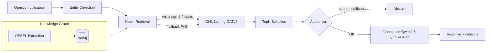

# GraphRAG & LLMOps — RAG sur graphe de connaissances, industrialisé en production

Pipeline QA multi-sauts sur **HotpotQA (distractor)** : extraction de triplets (REBEL) → graphe Neo4j → scoring GNN (GATv2) → génération Qwen2.5-1.5B fine-tuné QLoRA 4-bit, le tout orchestré par LangGraph et industrialisé (routage, cache, tracing, prompt versioning, éval continue).

> Contrainte matérielle : RTX 3050 Ti 4 Go — modèles figés dans `checkpoints/`, inference 4-bit obligatoire.

---

## Table des matières

1. [Pitch](#pitch)
2. [Architecture](#architecture-du-pipeline)
3. [Couche LLMOps](#couche-llmops-industrialisation)
4. [Résultats mesurés](#résultats-mesurés)
5. [Quickstart](#quickstart)
6. [Configuration (.env)](#configuration-env)
7. [Tests & qualité](#tests--qualité)
8. [Structure du dépôt](#structure-du-dépôt)
9. [Documentation](#documentation)
10. [Limites connues](#limites-connues)

---

## Pitch

**Problème** : la question-réponse multi-sauts (HotpotQA) exige de combiner plusieurs faits dispersés dans plusieurs documents. Le RAG classique hallucine (41 % sur le pipeline de base) et le retrieval lexical (BM25) ne propage pas l'information relationnelle.

**Solution** : pipeline en trois étages —
1. **Extraction de connaissances** : triplets REBEL stockés dans Neo4j (17 257 nœuds, 43 040 arêtes).
2. **Scoring GNN** : GATv2 (2 couches, hidden 128, + feature BM25) entraîné sur les *supporting facts*, qui propage les scores relationnels sur le graphe.
3. **Génération** : Qwen2.5-1.5B fine-tuné QLoRA 4-bit (LoRA r=16), réponse avec citations, abstention si preuves insuffisantes.

**Résultats clés** :
- **F1 test 0,264** / **EM 0,163** (config C5 : Run1 fusionné + GNN top-5).
- **Recall@5 des supporting facts : 0,901** — le GNN bat BM25 seul de **+0,022 R@5** (0,729 vs 0,707).
- **Format de réponse 100 % valide** après fine-tuning (0 % en base).
- **Latence 0,61 s/question**, modèle fusionné 1,81× plus rapide que l'adaptateur.

---

## Architecture du pipeline



Les 7 nœuds LangGraph : `EntityDetection → Neo4jRetrieval → PyGFallback → GNNScoring → TopKSelection → Abstention → Generation` (code : `src/orchestrator/`).

---

## Couche LLMOps (industrialisation)

| Composant | Fichier | Rôle |
|-----------|---------|------|
| **Routage** | `llmops/router.py` | Classification heuristique de complexité → mistral-small (simple) / mistral-large (complexe), fallback dégradé |
| **Adaptateur LLM** | `llmops/adapter.py` | Interface locale (Qwen 4-bit) / hébergé (Mistral), contrat commun |
| **Cache** | `llmops/cache.py` | Cache de réponses, traçabilité `prompt_version`, `route_taken` |
| **Pricing** | `llmops/pricing.py` | Coût USD par token (mistral-small ~$0,000011, mistral-large ~$0,000089) |
| **Tracing** | Langfuse | Un span par requête : tokens, coût, latence, `prompt_version`, entités, triplets |
| **Prompt registry** | `prompts/registry.yaml` | Version active par étape (`generation`, `judge`, `extraction`), rollback sans redémarrage (`make prompt-rollback`) |
| **A/B testing** | `scripts/ab_prompts.py` | Compare `generation_v1` vs `generation_v2` (règle d'abstention stricte + contrat de citation) |
| **Éval continue** | `eval/run_ragas.py` | RAGAS + juge, venv isolé via `eval/bootstrap.sh`, dataset doré gelé (`eval/datasets`, sha256) |

---

## Résultats mesurés

### Test (300 questions) — config C5 (Run1 fusionné + GNN top-5)

| Métrique | Test | Val |
|----------|------|-----|
| EM | **0,1633** | 0,1950 |
| F1 | **0,2636** | 0,2784 |
| Format OK | **99,7 %** | 100 % |
| Latence | **0,607 s** | 0,618 s |
| Supporting facts Recall@5 | **0,9009** | 0,9357 |

### Ablations retrieval (val)

| Configuration | R@5 |
|---------------|-----|
| **GNN A8 (GATv2 + BM25)** | **0,7292** |
| BM25 seul | 0,7074 |
| Neo4j sans GNN (1-2 hops + BM25) | 0,6634 |
| Neo4j + Cross-Encoder reranker | 0,4426 |

### Hallucination (100 réponses val, juge embedding bge-small, seuil 0,5)

**41 %** de réponses hallucinées, 59 % de claims supportés. Causes : erreurs de raisonnement (45 %), bruit GNN label=0 cité (35 %), info absente du top-5 (20 %). Détail : `reports/j14_hallucination.md`.

### Benchmarks LLMOps vs cibles

| Métrique | Baseline | Current | Cible | Statut |
|----------|----------|---------|-------|--------|
| Fidélité | N/A | N/A | ≥ 0,90 | NOT MET (nécessite éval RAGAS GPU) |
| p95 latence (ms) | 0 | 0 | ≤ 1200 | MET |
| Coût/requête (USD) | 0,0 | 0,0 | ≤ 0,002 | MET (modèle local) |
| Non-infériorité (drop > 5 %) | — | — | toutes métriques | PASSED |

*Mesure : `make bench` (`scripts/bench.py`, adapter fake, 56 questions).*

---

## Quickstart

```bash
# 1. Cloner et installer
git clone https://github.com/Mohamed-ettaouil12/graphrag-llmops.git
cd graphrag-llmops
python -m venv .venv && source .venv/bin/activate
pip install -r requirements.txt

# 2. Configurer l'environnement (voir section suivante)
cp .env.example .env

# 3. Lancer Neo4j
docker compose up -d neo4j && sleep 20

# 4. Lancer l'API
.venv/bin/python -m uvicorn src.api.main:app --host 0.0.0.0 --port 8000 --workers 1

# 5. Tester
curl -X POST "http://localhost:8000/ask" \
  -H "Content-Type: application/json" \
  -d '{"question": "What is the capital of France?"}'

# 6. Tests + démo + benchmark
.venv/bin/python -m pytest tests/ -v
.venv/bin/python scripts/demo.py
make bench
```

---

## Configuration (.env)

**`.env` n'est jamais commité** — copier `.env.example` et remplir les valeurs :

| Variable | Rôle | Défaut |
|----------|------|--------|
| `MISTRAL_API_KEY` | LLM hébergé (réservé au router LLMOps) | vide — pipeline 100 % local |
| `LANGFUSE_PUBLIC_KEY` / `LANGFUSE_SECRET_KEY` / `LANGFUSE_HOST` | Tracing Langfuse (brancheable sur les 7 nœuds) | vide / `https://cloud.langfuse.com` |
| `NEO4J_URI` / `NEO4J_USER` / `NEO4J_PASSWORD` | Accès Neo4j (aussi lu par `docker-compose.yml`) | `bolt://localhost:7687` / `neo4j` / — |

Sans clés API, le pipeline tourne en **mode dégradé local** : modèle Qwen 4-bit, spans Langfuse no-op, aucun appel externe.

---

## Tests & qualité

```bash
make test      # pytest (API, juge, adapter, pricing, dataset gelé, RAGAS runner)
make lint      # ruff
make check-env # validation des variables d'environnement
make bench     # benchmark vs baseline (reports/BASELINE.md)
make eval      # éval RAGAS (venv juge bootstrappé)
```

Tests unitaires : `tests/` — API (`test_api.py`, `test_api_query.py`), juge (`test_judge.py`), contrat adaptateur (`test_adapter_contract.py`), pricing (`test_pricing.py`), immuabilité dataset (`test_dataset_frozen.py`), scaffold LLMOps (`test_llmops_scaffold.py`).

---

## Structure du dépôt

```
graphrag-llmops/
├── app.py                      # Point d'entrée applicatif
├── src/
│   ├── api/                    # FastAPI (endpoints /ask, /health)
│   ├── orchestrator/           # Pipeline LangGraph (state, nodes, graph)
│   ├── gnn/                    # GATv2 (model, train, dataset, predict_topk)
│   ├── kg/                     # REBEL, Neo4j, normalisation, labelling
│   ├── llm/                    # QLoRA (train, eval, prompt, build_sft)
│   ├── pipeline/               # Pipeline legacy
│   ├── retrieval/              # Baselines BM25 / cosinus
│   ├── prep/                   # Préparation des splits
│   └── eval/                   # Évaluation EM/F1
├── llmops/                     # Couche industrialisation (router, adapter, cache, pricing)
├── prompts/                    # Registre versionné + templates Jinja2 (gen_v1/v2, judge, extraction)
├── eval/                       # Runner RAGAS + bootstrap venv juge + datasets gelés (sha256)
├── scripts/                    # demo, bench, ab_prompts, langfuse_smoke, validate_dataset…
├── tests/                      # Suite pytest
├── docs/adr/                   # ADR 0001 → 0004
├── reports/                    # Rapports d'étapes (j3…j16), baseline, SUMMARY, ab
├── configs/config.yaml         # Config globale
├── checkpoints/                # Modèles figés (gitignored)
├── data/                       # Données (gitignored)
├── docker-compose.yml          # Neo4j
├── Makefile · requirements.txt · requirements.lock
├── README.md · STATUS.md · rapport.md
```

---

## Documentation

| Fichier | Contenu |
|---------|---------|
| `rapport.md` | Rapport final complet (méthodes, résultats, limites) |
| `STATUS.md` | État d'avancement des 10 tâches, avec preuves |
| `reports/SUMMARY.md` | Benchmark vs cibles |
| `reports/BASELINE.md` | Baseline de référence (jamais éditée à la main) |
| `reports/metrics_resume.md` | Tableau unique de toutes les métriques |
| `reports/j12_final_test.md` | Éval finale test (EM/F1/recall/latence) |
| `reports/j13_ablations_final.md` | 3 ablations retrieval + GNN ref |
| `reports/j14_hallucination.md` | Analyse hallucination (41 %) |
| `docs/adr/0001…0004` | Décisions architecturales (init, prompt registry, prompt v2) |
| `prompts/registry.yaml` | Registre des versions de prompts actives |

---

## Limites connues

1. **Labelling paragraph-level** : 30,75 % des questions sans triplet positif → limite structurelle du recall.
2. **REBEL bruité** : relations non normalisées (3 966 relations uniques).
3. **GPU 4 Go** : contraint batch/longueur de séquence, élimine DPO et full fine-tuning.
4. **Hallucination 41 %** : modèle 1,5B + peu de données SFT (686 exemples, 2 epochs).
5. **Ablations évaluées sur val uniquement** (pas de comparatif test).

### Suites possibles
- Labelling phrase-level ou distant supervision.
- GNN top-10 + reranker cross-encoder fine-tuné sur triplets courts.
- Augmentation des données SFT ; DPO si GPU > 8 Go ; Qwen2.5-3B/7B quantisé.

---

## Reproductibilité

- Graine fixe `SEED=42` partout.
- Versions exactes dans `requirements.lock`.
- Dataset d'éval doré gelé avec empreinte sha256 (`eval/datasets`).
- Traces MLflow dans `mlruns/` (gitignored).
