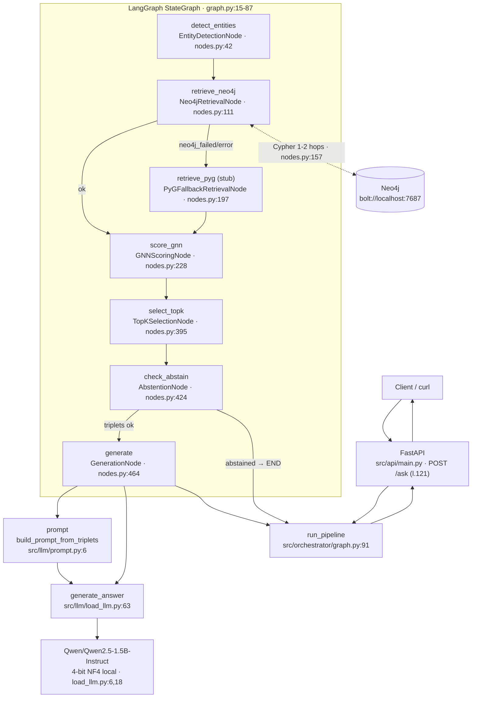

# Audit du code GraphRAG — socle LLMOps (P01)

> **Portée** : audit READ-ONLY du pipeline existant de `qa-multisaut` (HotpotQA distractor,
> anglais) + plan d'insertion de la couche LLMOps (P02+) **sans modifier un seul fichier legacy**.
> Fait le : 2026-11-01, branche `main` @ `6c09c4b`.

---

## 0. Écart signalé avec le contexte d'appel

Le cahier des charges P01 évoque un « corpus agricole, documents français, réponses via
Mistral ». **Ce dépôt n'appelle aucun modèle Mistral** : le corpus est HotpotQA (distractor,
anglais) et le LLM est **Qwen2.5-1.5B-Instruct en 4-bit local** (aucun appel réseau LLM).
Les clés `MISTRAL_API_KEY` / `LANGFUSE_*` demandées dans `.env.example` sont réservées au
futur router (llmops/router.py) et au tracing Langfuse (P02) ; elles ne sont **pas** utilisées
par le pipeline actuel.

## 1. Points d'entrée

| Événement | Commande | Code |
|---|---|---|
| API HTTP (prod par défaut) | `.venv/bin/python -m uvicorn src.api.main:app --host 0.0.0.0 --port 8000 --workers 1` | `src/api/main.py:40` (app), lifespan `main.py:21-37` |
| Démo locale | `.venv/bin/python scripts/demo.py` (3 questions + curl) | `scripts/demo.py:15` |
| Éval batch (hors runtime) | `PYTHONPATH=. .venv/bin/python -m src.eval.run_evaluation --config C5 --split test` | `src/eval/run_evaluation.py:174` |

Configuration runtime (contraintes VRAM 4 Go, `workers=1`, `max_new_tokens=64`) dans
`src/orchestrator/state.py:58` (classe `PipelineConfig`). Le fichier `configs/config.yaml`
n'est **pas lu à l'exécution** (aucun import yaml ; valeurs mortes).

### Commande qui tourne une requête aujourd'hui

```bash
docker compose up -d neo4j && sleep 20     # Neo4j requise par le nœud retrieve_neo4j
.venv/bin/python -m uvicorn src.api.main:app --host 0.0.0.0 --port 8000 --workers 1
curl -X POST "http://localhost:8000/ask" \
     -H "Content-Type: application/json" \
     -d '{"question": "What is the capital of France?"}'
```

Sans Neo4j (API + GPU + checkpoints présents), le nœud `retrieve_neo4j` bascule en
« `neo4j_failed` » et la génération est avortée (`AbstentionNode` → « Information insuffisante »).

## 2. Flux de requête complet (LangGraph, 7 nœuds)

Le graphe est construit dans `src/orchestrator/graph.py:15-87` ; l'orchestation applique
`run_pipeline(question, config)` à `src/orchestrator/graph.py:91-107`.



Détail par nœud (tous dans `src/orchestrator/nodes.py`) :

1. **`detect_entities`** (`EntityDetectionNode`, nodes.py:42-108) — charge `data/processed/kg_triplets.jsonl`
   (nodes.py:50-58), bge-small (`BAAI/bge-small-en-v1.5`, state.py:81), matching **substring** puis
   fallback embeddings (`_embedding_entity_match`, nodes.py:93). ⚠️ reconstruit l'ensemble des
   entités à **chaque requête** (nodes.py:69-73).
2. **`retrieve_neo4j`** (`Neo4jRetrievalNode`, nodes.py:111-194) — driver `neo4j.GraphDatabase`
   (nodes.py:119-129), Cypher 1-2 hops sur `(e:Entity)-[r1:REL]`/`[r2:REL]` (nodes.py:157-165).
3. **`retrieve_pyg`** (`PyGFallbackRetrievalNode`, nodes.py:197-225) — **stub** : renvoie vide,
   state `pyg_fallback_skipped`, mais recharge quand même kg_triplets.jsonl au init (nodes.py:202).
4. **`score_gnn`** (`GNNScoringNode`, nodes.py:228-304) — recharge `checkpoints/gnn_best.pt`
   (nodes.py:240-253) via `TripleScorerGNN_BM25` défini dans **`src/gnn/predict_topk.py:12`**
   (l'architecture `edge_proj` 770→hidden et `edge_scorer` 386→1 est reconstruite à la main,
   nodes.py:246-252) + scores BM25 (`rank_bm25`, nodes.py:381-392) ; graphe PyG ad-hoc via
   `_build_pyg_data` (nodes.py:306-379). Échec → fallback silencieux sur triplets non scorés
   (nodes.py:298-301).
5. **`select_topk`** (`TopKSelectionNode`, nodes.py:395-421) — filtre `gnn_score_threshold=0.1`,
   top `gnn_k=5` (state.py:62-63).
6. **`check_abstain`** (`AbstentionNode`, nodes.py:424-461) — `min_triplets_for_generation=1`,
   `max_score_threshold=0.0` (state.py:77-78) ; réponse figée « Information insuffisante »
   (nodes.py:451).
7. **`generate`** (`GenerationNode`, nodes.py:464-530) — construit le prompt
   (`build_prompt_from_triplets`, `src/llm/prompt.py:6-46`) puis appelle `generate_answer`
   (`src/llm/load_llm.py:63-77`, greedy). Parsing « Sources: » (`_parse_response`, nodes.py:520-530).

## 3. Modèles appelés et où

| Modèle | Rôle | Localisation appelée où | Dans le flux requête ? |
|---|---|---|---|
| `Qwen/Qwen2.5-1.5B-Instruct` | Génération | `src/llm/load_llm.py:6` (const `MODEL_NAME`), quantized NF4 `load_llm.py:11-24`; appelé par `GenerationNode._load_model` nodes.py:475 | ✅ oui |
| `BAAI/bge-small-en-v1.5` | Embeddings entités/relation | `src/orchestrator/state.py:81`, chargé **2 fois** (nodes.py:47 et nodes.py:256) | ✅ oui |
| `Babelscape/rebel-large` | Extraction triplets (REBEL) | `src/kg/extract_rebel.py` (pré-processing) | ❌ hors requête |
| GNN `gatv2_h128_l2 + BM25` | Scoring triplets | checkpoint `checkpoints/gnn_best.pt` via nodes.py:240 | ✅ oui |
| **Mistral (n'importe lequel)** | — | **aucun** | ❌ aucun appel Mistral |

> **Finding majeur (P2)** : `GenerationNode._load_model` (nodes.py:473-477) appelle
> `load_base_model(config.device, use_4bit=...)` **sans passer le chemin** : le champ
> `PipelineConfig.llm_path = "checkpoints/merged_final"` (state.py:71) **n'est jamais utilisé**.
> L'API recharge donc le Qwen *base* depuis HF (cache local) et non le Run1 fusionné utilisé
> lors des mesures j12. À corriger via llmops/adapter.py en P02 (wrap de chargement), sans
> toucher au legacy.

## 4. Configuration

- **Runtime** : defaults pydantic `PipelineConfig` (`src/orchestrator/state.py:58-86`) ;
  overridable seulement en code (API l.27 `PipelineConfig()`).
- **Fichier** : `configs/config.yaml` (seed 42, modèles, chemins) — **jamais lu par le code
  runtime** (aucun import yaml). Mort au moment de l'inférence.
- **Env** : aucune variable d'environnement lue par `src/api`, `src/orchestrator`, `src/llm`.
  Seules `mlflow` (scripts training) et docker-compose utilisent env.

## 5. Secrets

Valeur | Emplacement | Statut |
|---|---|---|
| Auth Neo4j runtime | `src/orchestrator/state.py:68` : `neo4j_auth = ("neo4j", "REDACTED")` | **hardcodé** (placeholder, pas de lecture env) |
| Auth Neo4j (peuplement) | `src/kg/load_neo4j.py:14` : `AUTH = ("neo4j", "REDACTED")` | hardcodé (redacté au commit `9ecc61f`) |
| Neo4j container | `docker-compose.yml:10,17` : `NEO4J_PASSWORD:-devpassword` | env OK avec défaut |
| Clés LLM/observabilité | aucune (`MISTRAL_*`, `LANGFUSE_*` inexistantes avant P01) | à venir via `.env.example` |
| `.env` dans `.gitignore` | `.gitignore:31,55` | ✅ déjà ignoré (`git check-ignore .env` ok) |

## 6. Tests existants

- `tests/test_api.py` — **5 tests smoke FastAPI** (TestClient ; 503 toléré si pipeline non
  chargé). Aucun test unitaire des nœuds, pas d'eval dans CI, pas de tests sur `llmops/`.
- Exécution : `.venv/bin/python -m pytest tests/ -v` → **5 passed** (baseline avant P01 : identique).
- Pas de CI : aucun dossier `.github/`, pas de lint.

## 7. Éval existante (hors CI)

- `src/eval/metrics.py` — EM/F1 style SQuAD (`exact_match`, `f1`).
- `src/eval/run_evaluation.py:32-38` — configs C1…C5 ; écrit `results/{config}_{split}.csv` ;
  stats console ; baseline Run1 : **Test F1 = 0.2636** (`reports/j12_final_test.md`).
- Hallucination mesurée ad-hoc (`reports/j14_hallucination.md`, juge bge-small).
- Aucun hook LLMOps : non reproductible via makefile avant P01 → targets `eval`/`bench` ajoutés.

## 8. Observabilité actuelle

- logging stdlib (`main.py:13`, `nodes.py:18`) INFO/ERROR.
- Chaque nœud peuple `*_log` dans le `PipelineState`
  (`entity_detection_log`, `neo4j_retrieval_log`, `gnn_log`, `selection_log`,
  `generation_log`, `state.py:29-43`) via `NodeBase.log` (nodes.py:34-39) — **jetées
  dès la fin de la requête** : donc aucune persistance, pas de spans, pas de token count.
- `POST /ask` renvoie `latency_ms` (main.py:130-138) ; `PipelineState.latency_ms` est
  peuplé mais jamais remonté à l'API.

## 9. Points d'insertion LLMOps (P02+, en *wrapping*, zéro modif legacy)

| Hook | Fichier cible du hook (nouveau) | Point legacy intercepté |
|---|---|---|
| **Tracing** | `llmops/adapter.py` — wrapper autour de `run_pipeline` (graph.py:91) ; spans par nœud reconstitués depuis les `*_log` du state (`state.py:29-43`) + temps de `api/main.py:130` | `src/orchestrator/graph.py:91` |
| **Tracing LLM/MLflow** (déjà heavyweight) | `llmops/adapter.py` — hook autour de `generate_answer` (`load_llm.py:63`) pour token count / mlflow-tracing | `src/llm/load_llm.py:63-77` |
| **Routing** | `llmops/router.py` — politique local Qwen (défaut, 0 $) vs API hébergée Mistral (branchement via `MISTRAL_API_KEY`) ; réattribue le choix à l'appel de génération | `GenerationNode` (nodes.py:464) via `adapter.py` |
| **Cache** | `llmops/cache.py` — cache réponse (clé : question normalisée) et cache embeddings (coût dominant = `SentenceTransformer.encode` sur toutes les entités par requête) | `src/llm/load_llm.py:63` et `src/orchestrator/nodes.py:93` |
| **Eval** | `eval/` — réutilise `src/eval/run_evaluation.py` + `src/eval/metrics.py`, sorties dans `reports/` | `make eval` |
| **Prompts versionnés** | `prompts/` — extraction du template de `src/llm/prompt.py:6-46` | hash du prompt en méta |
| **Ops / cost** | `ops/` — bench latence par nœud (`*_log.latency_ms`), bilan tokens | `make bench` |

Principe : couche externe (décorateurs/wrappers) importée **par la couche LLMOps**, jamais
l'inverse ; `src/` ne connaît pas `llmops/`.

## 10. Gap list

| # | Gap | Preuve (fichier:ligne) | Remplira P0x |
|---|---|---|---|
| G1 | Aucun tracing / export des logs de nœuds | `nodes.py:34-39`, `state.py:29-43` | P02 Langfuse |
| G2 | Pas de CI (ni `.github/` ni lint) | arborescence | P03 |
| G3 | Aucune lecture d'env dans le runtime API ; auth Neo4j placeholder hardcodée | `state.py:68`, `load_neo4j.py:14` | P02 (.env) |
| G4 | Pas de suivi tokens/coûts (modèle local = pas de $, mais tokens non mesurés) | `load_llm.py:63` | P02/P04 |
| G5 | Prompt hardcodé (template inline, non versionné) | `src/llm/prompt.py:6-46` | P03 prompts/ |
| G6 | Pas de cache (question + embeddings recomputés à chaque appel) | `nodes.py:69-73,93` | P03 cache.py |
| G7 | Pas de routing LLM (mono-modèle fixe) | `load_llm.py:6` | P04 router.py |
| G8 | `configs/config.yaml` mort au runtime | aucun import yaml dans `src/` | P02 adapter |
| G9 | `PipelineConfig.llm_path` ignoré → API = Qwen base, pas `merged_final` | `nodes.py:473-477` vs `state.py:71` | P02 adapter |
| G10 | Fallbacks silencieux (GNN failed → triplets bruts ; Neo4j down → abstention) non exportées à l'observabilité | `nodes.py:298-301`, `graph.py:46-60` | P02 |
| G11 | `pip install` non reproductible (`requirements.txt` sans versions) | `requirements.txt` vs `requirements.lock` | P03 |
| G12 | Tests min (5 smoke API), rien sur max_tokens/format/abstention | `tests/test_api.py` | P03 |
| G13 | `import json` placé en fin de `nodes.py` — la classe l'utilise avant que l'import ne s'exécute (fonctionne par accident) ; non corrigé en P01 | `nodes.py:533` | hors périmètre P01 |
